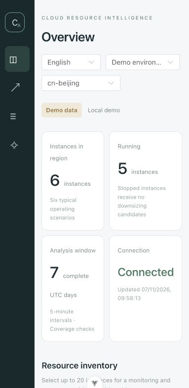

# CloudPilot · CloudAgent

A bilingual cloud operations workspace with resource inventory, monitoring-based cost analysis, analysis history, Markdown reports, and a multi-agent assistant.

The frontend supports English and Chinese. The Python backend combines FastAPI, LangGraph, MCP tools, hybrid retrieval, Milvus, Neo4j, Redis, and MySQL. The included demo uses six fictional operating scenarios and example prices.



## Run locally

Requirements: Docker with Compose, Python 3.11, and Node.js 22.12+ (or a compatible version listed in the frontend's `package.json`).

```bash
git clone https://github.com/lin123-ovo/cloud-agent.git
cd cloud-agent
python3.11 -m venv .venv
.venv/bin/python -m pip install -r requirements-local-lock.txt
npm --prefix front/cloud_agent ci
cp .env.docker.example .env.docker
cp agent/.env.example agent/.env
```

Edit the two local environment files before startup:

- Set your own `DASHSCOPE_API_KEY` in `agent/.env`.
- Replace the password placeholders in `.env.docker`.
- Set `MYSQL_PASSWORD` and `NEO4J_PASSWORD` in `agent/.env` to the matching Docker passwords.

Start Docker, then run:

```bash
./scripts/start.sh
```

Open the [English workspace](http://127.0.0.1:5173/?lang=en), [Chinese workspace](http://127.0.0.1:5173/?lang=zh), or [API documentation](http://127.0.0.1:5001/docs).

For a new installation, initialize the knowledge base after startup:

```bash
./scripts/init-knowledge.sh --initialize
```

Knowledge initialization calls paid model APIs and rebuilds the project's `cloud_product_docs` vector collection. Run it only when initialization or an intentional rebuild is needed. Existing installations can keep their local environment files and database volumes.

Stop the application with `./scripts/stop.sh`. Runtime logs stay in `.local/`; Docker data volumes are retained.

## Project layout

| Directory | Purpose |
| --- | --- |
| `front/cloud_agent/` | Vue and TypeScript workspace |
| `app/` | FastAPI endpoints, SSE chat, and cache |
| `agent/` | Agent workflows, MCP, memory, and retrieval |
| `cloudops/` | Resource providers, monitoring rules, reports, and persistence |
| `mock_data/` | Example knowledge and graph data |
| `tests/` | Offline checks and opt-in database integration tests |
| `scripts/` | Local startup, initialization, and evaluation |
| `evaluation/` | Recorded evaluation outputs and demo screenshots |

## Validation

```bash
PYTHONPATH=agent:app .venv/bin/python -m pytest tests/agent tests/ops/test_rules.py tests/ops/test_aliyun.py -q
npm --prefix front/cloud_agent run build
```

Recorded evaluation files describe individual local runs. They do not establish production accuracy or verified cloud savings. Database integration tests are opt-in; see the operations guide before running them.

## Scope and documentation

This is a local, single-operator analysis workspace. It does not modify cloud resources. Alibaba Cloud adapters have mock-response tests; end-to-end validation against a real cloud account remains incomplete. Demo cost estimates use example prices and exclude disks, networking, and discounts.

Real credentials, installed dependencies, local logs, caches, and database contents are excluded from Git. Existing upstream source notices are retained.

- [Local setup (English)](LOCAL_SETUP.en.md)
- [Local setup (中文)](LOCAL_SETUP.md)
- [Operations guide](OPS_WORKBENCH.md)
- [Agent optimization](docs/agent-optimization.md)
- [Bilingual implementation notes](docs/english-version.md)
